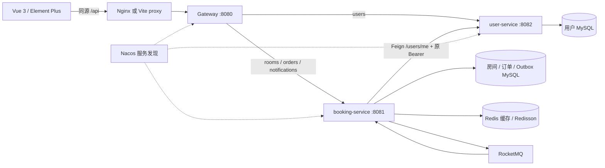

# SmartOffice 最终架构

目录更新日期：2026-10-17。前端工程位于 frontend，Maven 聚合工程位于 backend，部署入口位于 deploy；本次只调整目录，不变更服务边界。本地演示与工程验证用途；本次验证状态见 directory-layout-verification.md，下面真实中间件结果为历史证据。

四个 Maven 模块已编译为共享库和三个独立服务 JAR。2026-10-14完整Docker十容器实际启动并healthy；真实MySQL8.0.46、Redis7.4.11、RocketMQ5.3.1、Nacos3.0.3、Gateway/Feign发现调用和Sentinel限流均已验收，当前镜像Edge浏览器链路通过。工程H2/Mock测试另行保留，不计入真实中间件结果；命令与边界见[real-integration-report.md](real-integration-report.md)。

## Maven 与服务边界

| 目录 / artifact | 责任 | 写入数据 |
|---|---|---|
| backend / smartoffice-parent | Boot 与 Cloud BOM、Java17、模块聚合、统一测试配置 | 无 |
| backend/shared / smartoffice-shared | JWT、角色与身份、Result、异常处理、Spring Security/CORS、AOP 基础 | 无；不共享 Mapper/数据库实体 |
| backend/user-service / smartoffice-user-service | 登录、注册、当前有效用户查询 | 仅 sys_user |
| backend/booking-service / smartoffice-booking-service | 会议室、预约、取消、缓存、限流、消息生产/消费、管理员导出 | meeting_room、booking_order、booking_outbox、message_consumption、booking_notification、business_event_audit |
| backend/gateway / smartoffice-gateway | 路由、/api 前缀处理、移除伪造身份头、健康检查 | 无；使用 WebFlux，不依赖 MVC shared |
| frontend/src | Vue 前端：注册/我的预约/取消/幂等提交 | 浏览器保存 JWT |

两个业务库不做跨库写或联表事务。订单里的 user_id 是用户服务身份引用；创建前通过 Feign 验证，不在事务里修改用户数据。用户与订单不需要分布式事务。房间与预约必须保留在同一服务，否则房间锁与状态更新会变成跨服务一致性问题。

## 一致性与降级

预约数据库事务采用 READ_COMMITTED，锁定会议室行后检查半开时间区间，写订单及 Outbox。Redisson watchdog 房间锁用于降低数据库竞争；Redis 锁失败时，数据库行锁仍是最终互斥来源。取消和管理员变更使用同一房间行锁，订单取消为条件更新。

缓存仅用于详情展示。列表查询与预约判定走数据库，不以缓存的 AVAILABLE 状态决定预约是否成功。提交后清详情缓存；Lua 条件回填阻止旧查询重新写入成功失效后的值。Redis 故障时查库；失效失败最终由 TTL 收敛，无法宣称所有故障下展示数据强一致。

预约成功事件与订单同事务记录 Outbox。发送在事务外进行，租约/CAS、退避和重复消费保护构成至少一次投递方案。通知与审计在同一消费者事务中持久化；这不是跨系统 exactly-once。

## 认证、路由与保护

后端各自验证签名、过期、uid/subject/role/expiration。网关保留 Authorization，删除 X-User-Id/X-User-Role/X-Username/X-Internal-*，不将普通请求头当作身份。绕过网关直连业务服务仍需 JWT。方法权限控制保护管理接口；取消通过数据库订单所有权判断。用户资料接口从用户库读取有效身份。

新预约入口使用 Sentinel 手动资源 `smartoffice:booking:create`，默认单实例 20 QPS，可用 BOOKING_QPS 配置，不依赖控制台。只有新预约调用用户服务，查询/取消不会因用户服务短暂故障增加远程依赖。JWT 有效期内的普通查询与管理员请求仍为本地令牌权限，不实现立即全局撤权。

## 运行模式和版本

local：不启用 Nacos，Gateway/Feign 使用 localhost 直连；MQ 默认关闭，Outbox 保留待发送事件。cloud：启用 Nacos，Gateway 与空 URL 的 Feign 使用服务名，Compose 启用 MQ。Nacos 当前只注册发现，不使用配置中心，因此没有不必要的远程配置启动依赖。

Java17 / Boot3.5.13 / Cloud2025.0.0 / Alibaba2025.0.0.0 / Nacos3.0.3 / Sentinel1.8.9 / RocketMQ Java SDK5.3.1。依据 [Alibaba 官方矩阵](https://sca.aliyun.com/docs/2025.x/overview/version-explain/) 与 [Spring 官方版本关系](https://github.com/spring-cloud/spring-cloud-release/wiki/Supported-Versions)；不关闭兼容性校验。MyBatis-Plus3.5.12、Redisson3.50.0、JJWT0.12.6 保留原项目版本。
